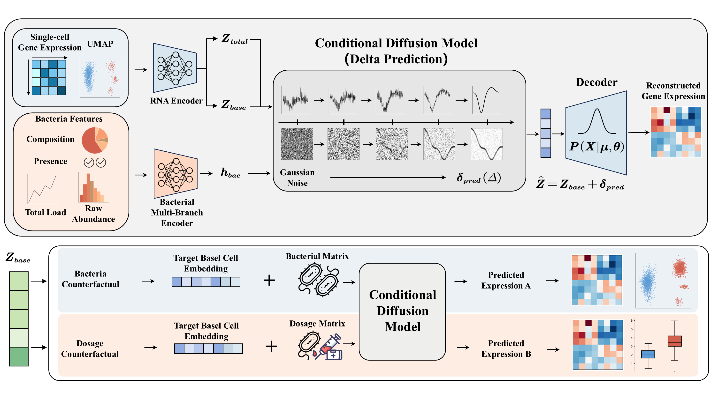

# BacDiff

BacDiff models bacterial perturbation effects on single-cell RNA expression with a variational encoder, conditional latent diffusion, and a Negative Binomial decoder. It includes data preparation, model training, held-out evaluation, and counterfactual dose scans.

## Model overview

The RNA encoder produces base and total cell embeddings. A bacteria-conditioned diffusion model predicts the latent shift, which the decoder maps back to gene expression. The lower panel illustrates bacteria and dose counterfactuals.



## Repository layout

```text
bacdiff/
  data/       AnnData dataset, merging, and conversion tools
  models/     Neural networks and loss functions
  utils/      Configuration, random seed, and device helpers
  cli/        Training, evaluation, inference, and plotting commands
configs/      Dataset-specific YAML configurations
notebooks/    Exploratory and data inspection notebooks
```

## Setup

Use Python 3.11 or newer in a virtual environment:

```bash
python -m venv .venv
source .venv/bin/activate
python -m pip install --upgrade pip
python -m pip install -r requirements.txt
```

Datasets and trained checkpoints are not included. Put the merged AnnData file at the path configured by `data.merged_h5ad`, or update that setting. The merged object must contain `obsm["bacteria_raw"]`, `uns["bacteria_names"]`, and `obs["bacteria_label"]`; controls use the label `none`. For configs with `preprocess.log1p_input: true`, `X` is treated as counts and normalized/log-transformed for model input. Reconstruction targets are read from `X`.

## Main workflow

Run commands from the repository root. The default config expects `data/OSCC_11_merged.h5ad`:

```bash
python -m bacdiff.cli.train --config configs/config.yaml
python -m bacdiff.cli.evaluate --config configs/config.yaml
python -m bacdiff.cli.infer_counterfactual --config configs/config.yaml --sample-n 128
python -m bacdiff.cli.visualize_results --config configs/config.yaml
```

For CPA-style Sci-Plex metrics, also provide the original annotated file:

```bash
python -m bacdiff.cli.evaluate_cpa_style --config configs/config_sciplex.yaml --original_h5ad /path/to/original_sciplex.h5ad
```

Other configs are provided for OSCC15, M5, M20, and Sci-Plex. Edit their data paths and training settings for your environment.

## Sci-Plex 3 OT benchmark

The repository also contains the unpaired Sci-Plex 3 OT experiment. It holds
out complete cell-line by drug pairs while keeping all doses, exposure times,
and replicates of each pair together. This is a known-drug cross-cell-line
transfer task, not an unseen-drug or dose-extrapolation benchmark.

The data contain separate vehicle and treated populations; they do not contain
before/after measurements of the same cell. During OT training,
`bacdiff.data.sciplex3_pairing.ConditionPairer` first restricts vehicle
candidates to the same cell-line and time context, then samples a balanced
entropic Sinkhorn coupling in frozen VAE latent space. The resulting
vehicle-treated assignments are pseudo-pairs used to form latent residuals;
they are not observed single-cell trajectories.

Prepare the labeled 500-HVG benchmark from the downloaded GEO files:

```bash
python checking_data/prepare_sciplex3_pair_ood.py \
  --raw-dir data/sciplex3_raw \
  --output data/sciplex3_pair_ood_500hvg.h5ad
```

Train and generate the OT model:

```bash
python -m bacdiff.cli.sciplex3_pair \
  --config configs/config_sciplex3_pair_ood.yaml --mode both --split ood
```

To compare centroid, random, and OT matching with a frozen VAE:

```bash
python -m bacdiff.cli.sciplex3_pair_ablation fit \
  --config configs/config_sciplex3_pair_ablation.yaml --arm ot
python -m bacdiff.cli.sciplex3_pair_ablation predict \
  --config configs/config_sciplex3_pair_ablation.yaml --arm ot --split ood
```

The common scorer reports Energy/MMD distribution distances, mean expression
metrics, treatment-effect correlation, response strata, pair-level summaries,
and bootstrap contrasts. It uses train-only PCA and kernel calibration. The
evaluation scripts are in `checking_data/`; datasets, checkpoints, and output
tables are intentionally excluded from Git.

## Data preparation

Put paired GEX and 16S files in `data/`, then merge the OSCC15, M5, and M20 datasets:

```bash
python -m bacdiff.data.merge_all
```

The merger aligns cells by `obs_names`, rejects mismatched cell ID sets, filters rare bacterial features and labels, then writes merged files into `data/`. To convert a prepared Sci-Plex file:

```bash
python -m bacdiff.data.prepare_sciplex --input /path/to/sciplex.h5ad --output data/sciplex_merged.h5ad
```

## Outputs

Training writes checkpoints, the effective config, a CSV log, and a loss plot under `outputs/<run_name>/`. Evaluation writes metrics and plots under `eval/`; counterfactual inference writes result tables, arrays, and plots under `counterfactual/`.

Datasets, checkpoints, and generated outputs are excluded by `.gitignore`. Obtain source datasets according to their original licenses and access terms.
